# EcoBot: Raízes do Amanhã

Jogo de plataforma 2D feito na **Unity 6** com **C#**, desenvolvido como projeto da disciplina de Game Development (UniFECAF).

> A Floresta de Verdália está sendo sufocada pelo lixo e pela fumaça da Fábrica Cinzenta. Você controla **Eco**, um pequeno robô reciclador despertado pela última árvore da floresta. A missão dele é recuperar as Sementes Ancestrais, reciclar as criaturas de lixo e plantar a Muda Ancestral em cada região até chegar à Chaminé Final.

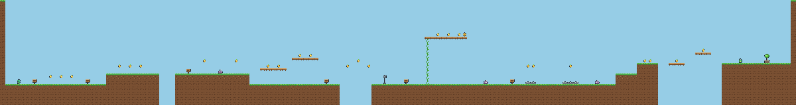

---

## Sumário
- [Como jogar](#como-jogar)
- [Mecânicas](#mecânicas)
- [Fases](#fases)
- [Como abrir e executar](#como-abrir-e-executar)
- [Estrutura do projeto](#estrutura-do-projeto)
- [Arquitetura do código](#arquitetura-do-código)
- [Editor de fases em texto (ASCII)](#editor-de-fases-em-texto-ascii)
- [Arte, áudio e créditos](#arte-áudio-e-créditos)
- [Prints](#prints)
- [Documentação](#documentação)

---

## Como jogar

| Ação | Teclado | Gamepad |
|---|---|---|
| Andar | `A` / `D` ou `←` / `→` | Analógico / D-pad |
| Correr | Segurar `Shift` | Segurar `X` |
| Pular | `Espaço` (segure para pular mais alto) | `A` |
| Escalar cipós e escadas | `W` / `S` ou `↑` / `↓` | Analógico |
| Descer de uma plataforma | `↓` + `Espaço` | Baixo + `A` |
| Pausar | `Esc` ou `P` | `Start` |
| Tirar print | `F12` | — |
| Ligar/desligar o som | `M` | — |

**Objetivo:** chegar à Muda Ancestral no fim de cada fase. Pelo caminho:

| Item / objeto | Efeito |
|---|---|
| Semente dourada | +100 pontos (pegar todas da fase dá +1000 de bônus) |
| Bateria | Recupera 1 de energia (se já estiver cheia, vira pontos) |
| Folha dourada | +1 vida |
| Estação de recarga | Checkpoint: salva o ponto de renascimento e recarrega a energia |
| Pisar em inimigo | +200 pontos |
| Terminar rápido | Bônus de tempo (10 pontos por segundo abaixo do tempo-alvo) |

O Eco tem **3 de energia** por vida. Inimigos e espinhos tiram 1 de energia, com recuo e alguns segundos de invencibilidade. Cair num abismo ou no lodo tóxico custa uma vida inteira. Sem vidas, aparece a tela de Game Over com a opção de tentar a fase de novo.

---

## Mecânicas

**Movimento** ([PlayerController.cs](Assets/Scripts/Player/PlayerController.cs))
- **Andar e correr** com aceleração e desaceleração (o personagem não para nem arranca de forma brusca).
- **Pulo responsivo:**
  - *coyote time*: ainda dá para pular um instante depois de sair da borda;
  - *jump buffer*: o pulo apertado um pouco antes de tocar o chão também vale;
  - *altura variável*: soltar o botão cedo corta o pulo;
  - gravidade maior na descida, para o pulo ficar mais firme.
- **Escalar** cipós e escadas, que centralizam o personagem na coluna. É possível agarrar no ar e pular de um cipó para outro.
- **Plataformas de mão única**: dá para atravessar por baixo e descer com `↓ + Espaço`.
- **Plataformas móveis** levam o jogador junto, e **plataformas rachadas** desabam logo depois de pisadas.
- **Squash & stretch** (o sprite estica no pulo e achata na aterrissagem) e partículas de poeira.

**Inimigos** ([Assets/Scripts/Enemies](Assets/Scripts/Enemies))

| Inimigo | Comportamento | Pode pisar? |
|---|---|---|
| Gosma de Lixo | Patrulha e vira ao encontrar parede ou borda | Sim |
| Ouriço de Sucata | Patrulha mais rápido e tem espinhos nas costas | **Não**, é preciso pular por cima |
| Drone de Fumaça | Voa em vai-e-vem balançando | Sim, e serve de "trampolim" |

**Feedback ao jogador**
- **Visual:** partículas ao coletar, pisar, levar dano e terminar a fase; textos flutuantes ("+100", "+1 VIDA"); personagem piscando durante a invencibilidade; tela tremendo ao levar dano; ícones do HUD que "pulsam" quando o valor muda.
- **Sonoro:** efeitos para pulo, aterrissagem, coleta, energia, vida extra, dano, pisão, checkpoint, plataforma desabando, fase concluída, game over e navegação nos menus. Cada fase tem uma trilha própria, além do menu e da tela final.

**HUD** ([HUD.cs](Assets/Scripts/UI/HUD.cs)): vidas, células de energia, sementes da fase (coletadas/total), pontuação, tempo, nome da fase, dicas das placas e painéis de pausa, fim de fase e game over.

---

## Fases

| # | Fase | Novidades | Elementos |
|---|---|---|---|
| 1 | **Floresta Despertar** | Tutorial com placas: andar, pular, correr, escalar, pisar em inimigos, espinhos | 25 sementes, 3 gosmas, 1 checkpoint |
| 2 | **Caverna das Raízes** | Ouriços (não dá para pisar), plataformas que desabam, cipós sobre o abismo, corredor baixo | 20 sementes, 5 ouriços, 7 plataformas rachadas |
| 3 | **Fábrica Cinzenta** | Lodo tóxico, plataformas móveis horizontais e verticais, drones voadores, descida de plataformas | 17 sementes, 6 plataformas móveis, 3 drones |
| 4 | **Chaminé Final** | Subida vertical que combina tudo o que foi aprendido | 16 sementes, 4 drones, 4 ouriços, 3 checkpoints |

A dificuldade cresce porque cada fase apresenta um desafio novo em um lugar seguro e depois o combina com os anteriores. Mapas completos:

<details>
<summary>Ver mapas das 4 fases</summary>

**Fase 1: Floresta Despertar**


**Fase 2: Caverna das Raízes**
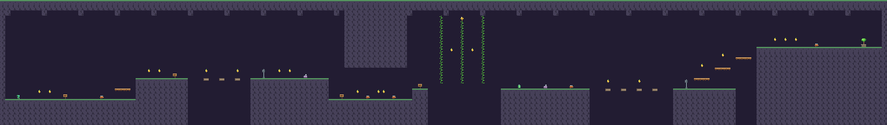

**Fase 3: Fábrica Cinzenta**
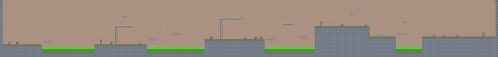

**Fase 4: Chaminé Final**
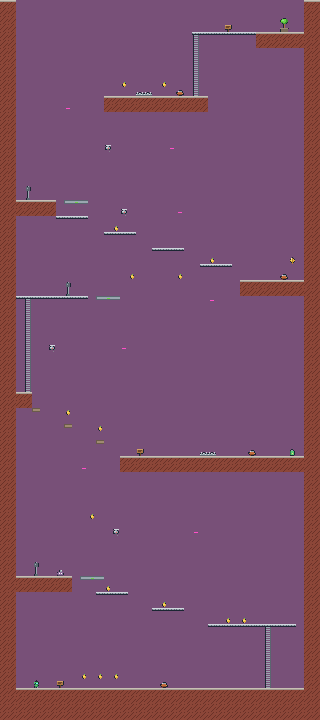

</details>

---

## Como abrir e executar

### Jogar o executável
1. Baixe o `.zip` da entrega e extraia.
2. Execute `EcoBot.exe` (Windows 64 bits).

### Abrir o projeto na Unity
1. Instale o **Unity Hub** e uma versão **Unity 6 (6000.x LTS)** com o módulo *Windows Build Support*.
2. No Unity Hub: **Add → Add project from disk** e selecione esta pasta. Se a versão for diferente, aceite abrir com a versão instalada.
3. Com o projeto aberto, use o menu **EcoBot → 1. Gerar projeto completo**. Ele cria as animações, prefabs, tiles e as 6 cenas (menu, 4 fases e vitória).
4. Abra `Assets/Scenes/MainMenu.unity` e aperte **Play**. Qualquer fase também pode ser testada direto: abra a cena `Level1..4` e aperte Play.

### Gerar o executável
- Menu **EcoBot → 2. Exportar executável (Windows)**. O jogo é gerado em `Builds/Windows/EcoBot.exe`.
- Ou pelo caminho padrão: *File → Build Profiles* (as cenas já estão na lista).
- Pela linha de comando (sem abrir o editor):
  ```
  Unity.exe -batchmode -quit -projectPath . -executeMethod EcoBot.EditorTools.EcoBotBuilder.BatchBuildAll
  ```

---

## Estrutura do projeto

```
Assets/
├── Art/Sprites/        Sprites pixel-art (personagem, inimigos, itens, tiles, fundos, UI, partículas)
├── Audio/SFX/          Efeitos sonoros (.wav)
├── Audio/Music/        Trilhas de cada fase (.wav)
├── LevelData/          Mapas das fases em texto (Level1..4.txt)
├── Scripts/
│   ├── Core/           GameManager, AudioManager, GameInput, Effects, SceneFader, LevelInfo, Bootstrap
│   ├── Player/         PlayerController (movimento), PlayerHealth (energia/vidas)
│   ├── Enemies/        Enemy (dano/pisão), PatrolMover, FlyingMover
│   ├── Level/          Collectible, Checkpoint, Hazard, MovingPlatform, FallingPlatform, Climbable, LevelGoal...
│   ├── Camera/         CameraFollow (suavização, limites, tremor), ParallaxLayer
│   └── UI/             HUD, MainMenu, VictoryScreen, FloatingText, UIButtonSfx
├── Editor/             Construtor do projeto (menu "EcoBot") e configurações de importação
│
│   (criados pelo menu EcoBot → 1)
├── Animations/         AnimationClips e Animator Controllers
├── Prefabs/            Jogador, inimigos, itens, objetos de fase, partículas
├── Tiles/              Tiles do Tilemap
├── Resources/          Systems.prefab (gerenciadores carregados automaticamente)
└── Scenes/             MainMenu, Level1..4, Victory
Tools/                  Scripts Python que geram os sprites, os sons e as imagens dos mapas
Docs/                   Mapas das fases, rascunho do relatório e roteiro do vídeo
```

---

## Arquitetura do código

- **Game loop da Unity:** a leitura de controles e as animações ficam no `Update`; a física (velocidade, gravidade, detecção de chão) fica no `FixedUpdate`; a câmera e o parallax ficam no `LateUpdate`, depois que tudo já se moveu.
- **Gerenciadores persistentes:** `Bootstrap` cria o prefab `Systems` antes da primeira cena (`RuntimeInitializeOnLoadMethod`). Ele contém `GameManager`, `AudioManager`, `Effects` e `SceneFader`, que sobrevivem à troca de cenas (`DontDestroyOnLoad`).
- **Eventos (C# `event`):** o `GameManager` avisa quando os números mudam, quando a fase começa ou termina, no game over e na pausa. O `HUD` apenas escuta esses eventos, sem lógica de jogo dentro da interface.
- **Componentização:** o inimigo é a soma de `Enemy` (dano e pisão) com um "motor" (`PatrolMover` ou `FlyingMover`). Para criar um inimigo novo basta trocar o motor.
- **Animator (máquina de estados)** do Eco: `Idle ⇄ Walk ⇄ Run`, `Jump`, `Fall`, `Climb`, `Hurt` e `Win`, controlados pelos parâmetros `Speed`, `Grounded`, `VelY`, `Climbing`, `ClimbMove` e pelos gatilhos `Hurt` e `Win`.
- **Input unificado** (`GameInput`): funciona com o Input Manager clássico e com o novo Input System, no teclado e no gamepad.

---

## Editor de fases em texto (ASCII)

As fases são desenhadas em arquivos de texto ([Assets/LevelData](Assets/LevelData)). O construtor lê cada caractere e monta a cena: tiles no Tilemap, colisores unificados (`CompositeCollider2D`), prefabs e decoração automática.

| Caractere | Elemento | Caractere | Elemento |
|---|---|---|---|
| `#` | Terreno sólido | `P` | Início do jogador |
| `=` | Plataforma de mão única | `G` | Muda Ancestral (fim) |
| `H` | Cipó / escada | `C` | Estação de recarga (checkpoint) |
| `~` | Lodo tóxico | `o` | Semente |
| `^` | Espinhos | `b` | Bateria |
| `s` | Gosma de Lixo | `L` | Folha dourada |
| `h` | Ouriço de Sucata | `F` | Plataforma rachada |
| `d` | Drone (vai até o `:` na linha) | `M` | Plataforma móvel horizontal (até o `:`) |
| `1`–`9` | Placa de dica | `V` | Plataforma móvel vertical (até o `:` acima) |

Para mudar uma fase: edite o `.txt` e rode **EcoBot → 1** de novo. Para ver o mapa como imagem: `python Tools/render_level_preview.py`.

---

## Arte, áudio e créditos

- **Sprites (pixel art 16×16):** originais, desenhados por código em [Tools/generate_sprites.py](Tools/generate_sprites.py) (personagem, 3 inimigos, itens, 4 conjuntos de tiles, decoração, fundos com parallax, UI e partículas).
- **Áudio:** original, sintetizado em [Tools/generate_audio.py](Tools/generate_audio.py) (15 efeitos e 6 músicas no estilo chiptune).
- **Fonte:** LegacyRuntime (fonte padrão da Unity).
- **Engine:** Unity 6, C#.

Para regenerar a arte e o som: `python Tools/generate_sprites.py` e `python Tools/generate_audio.py` (Python 3, sem bibliotecas extras).

---

## Prints

| | |
|---|---|
| 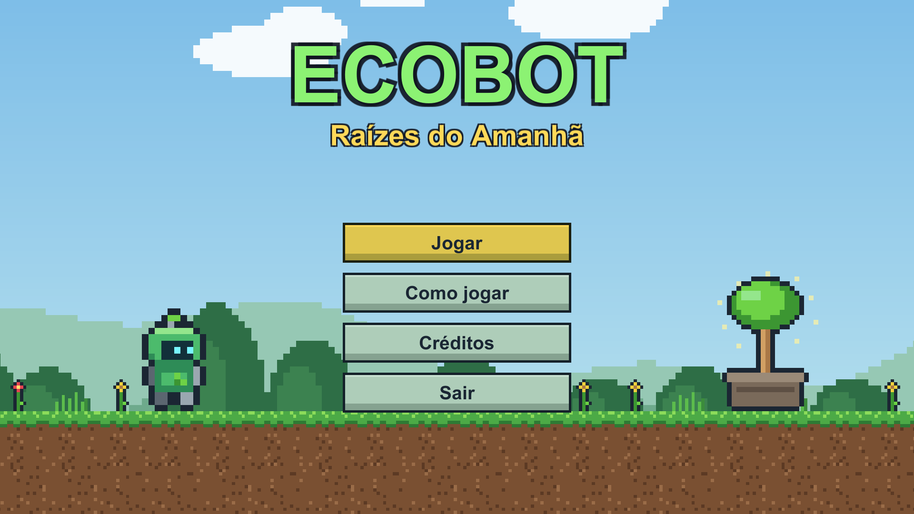 | 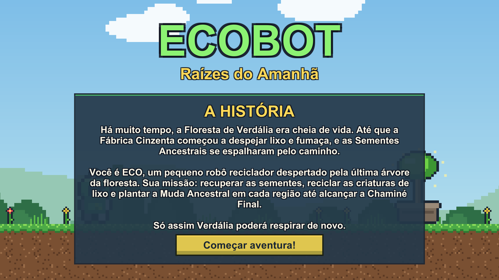 |
| Menu principal | Tela de história |
| 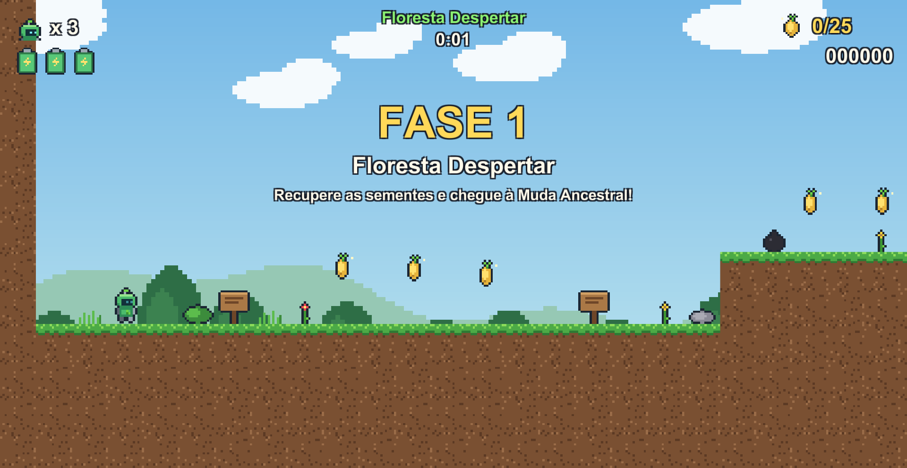 | 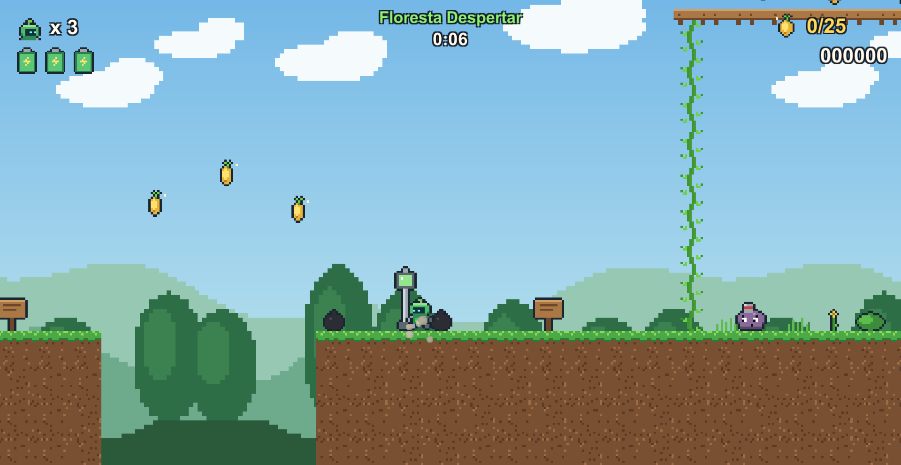 |
| Fase 1: Floresta Despertar | Checkpoint, cipó e Gosma de Lixo |
| 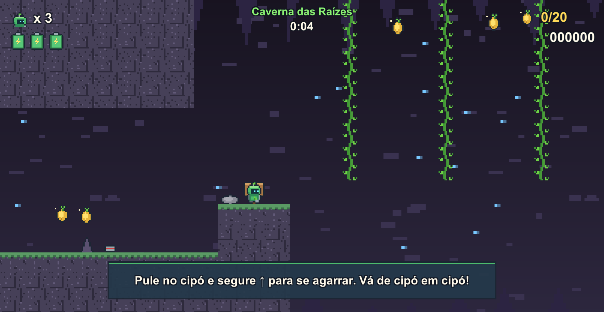 | 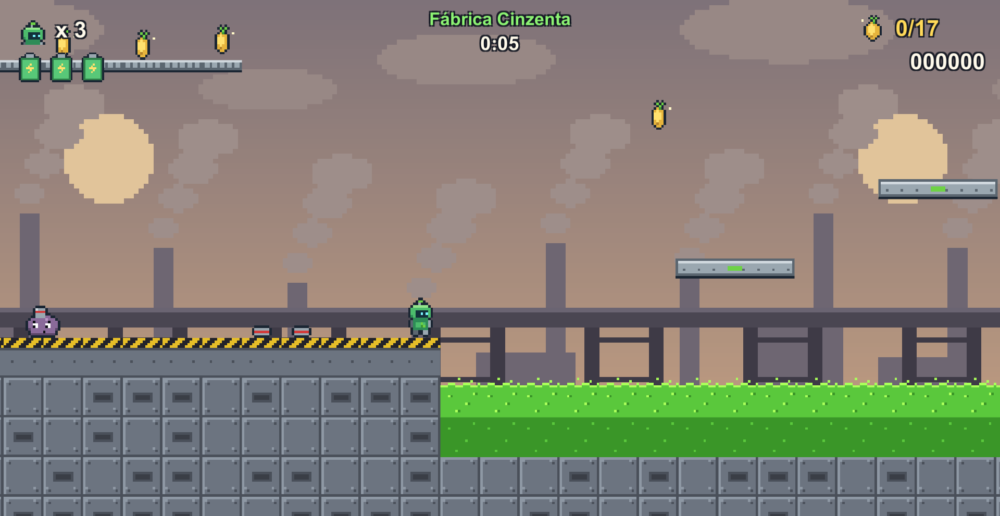 |
| Fase 2: Caverna das Raízes | Fase 3: Fábrica Cinzenta |
| 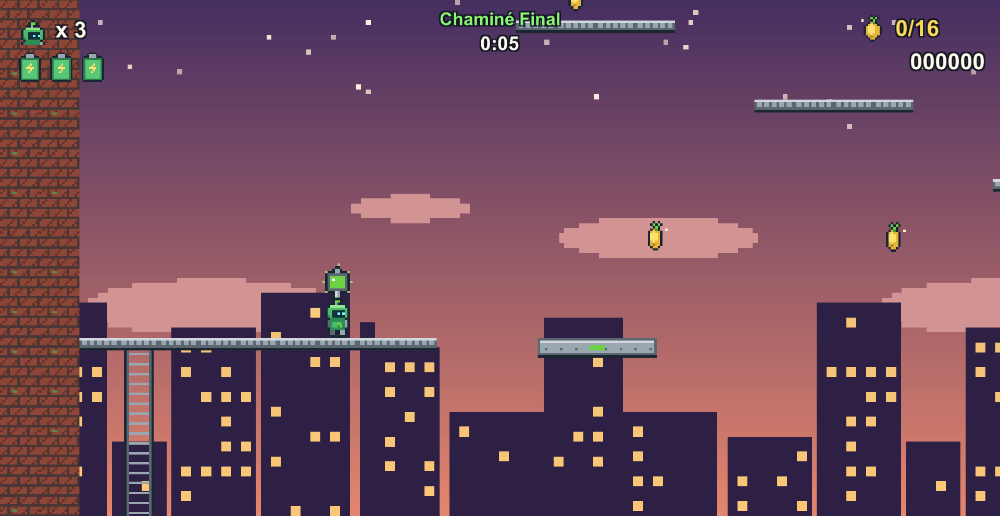 | 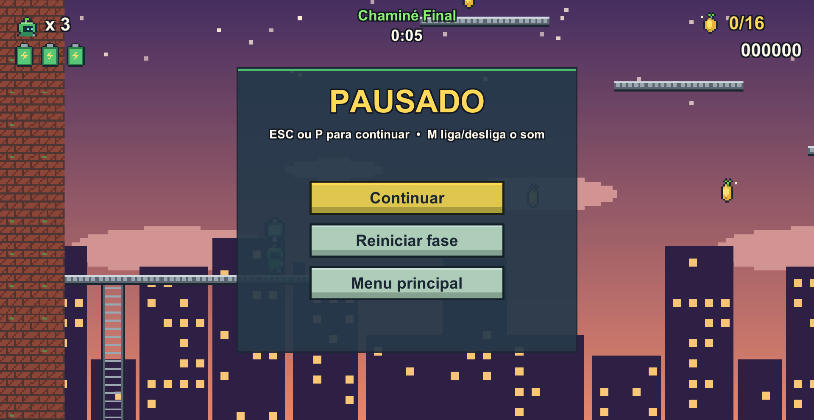 |
| Fase 4: Chaminé Final | Menu de pausa |
| 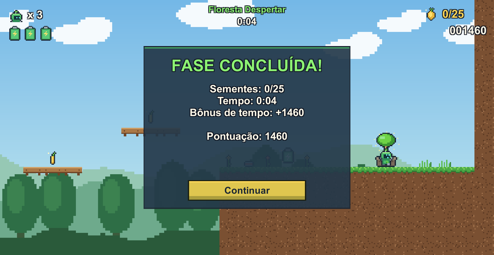 | 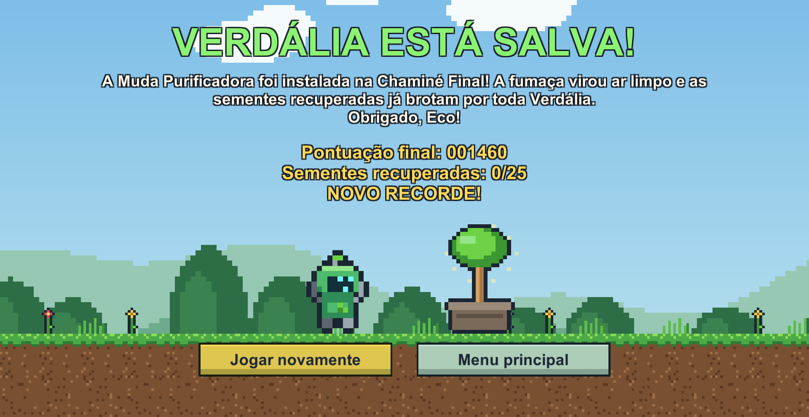 |
| Painel de fase concluída | Tela final |

> Os prints são gerados automaticamente: `EcoBot.exe -tour <pasta>` percorre o jogo e salva as imagens. Durante o jogo, **F12** salva um print na pasta `Prints` ao lado do executável.

---

## Documentação

- [Relatório teórico (PDF)](Docs/Relatorio_Teorico_EcoBot.pdf)
- [Mapas das fases](Docs/Mapas)
